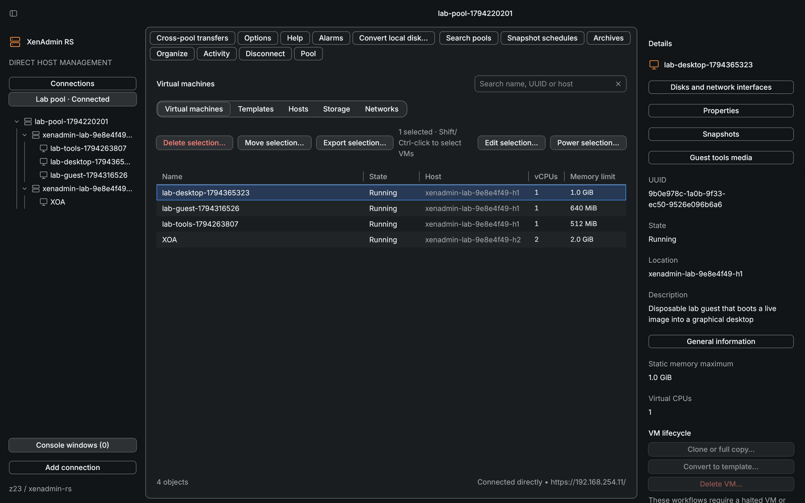
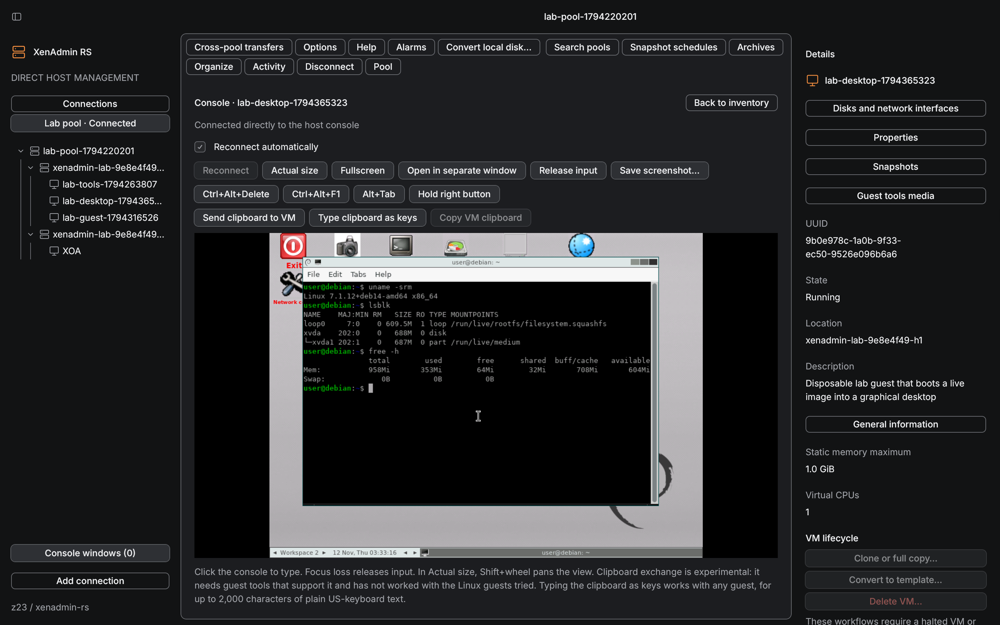
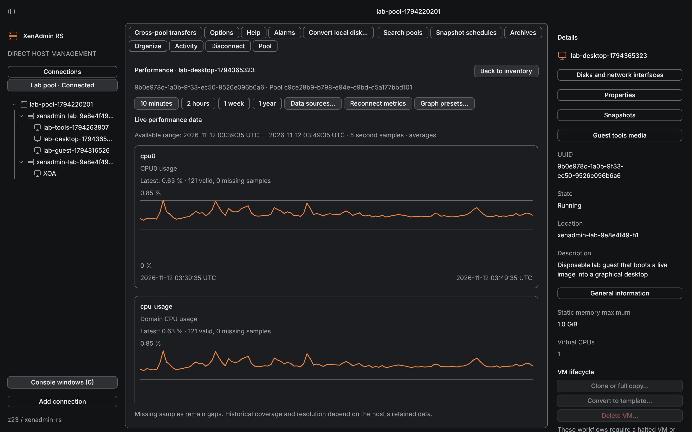

# XenAdmin RS

A Linux desktop client for direct management of XCP-ng hosts and pools.
The UI uses Rune. The backend uses Rust and XAPI.

The client must work when Xen Orchestra is unavailable. Connections, credentials,
inventory, VM consoles, and host discovery must work without an XO service.
The client requires a reachable XAPI service and the user's host permissions.



*The inventory of a pool the client is connected to directly: its two hosts and their
guests in the tree, each guest's state, host and size in the table, and the selected
guest's details and actions on the right.*



*A guest's console, opened through the host that runs the guest. Keyboard and pointer go
to the guest, and text on the clipboard can be typed into it as key presses.*



*A guest's performance, read from its host every five seconds, with longer ranges and a
choice of data sources.*

The pictures are of version 0.19.0 connected to the project's
[disposable lab](lab/README.md), a pool of two nested XCP-ng 8.3 hosts.

## Project status

Beta. Version 0.19.0 is the current release
([packages](https://github.com/z23/xenadmin-rs/releases/tag/v0.19.0),
[changelog](CHANGELOG.md), [release report](docs/reports/2026-11-12-release-0.19.md)), for
XCP-ng 8.3 with the client running as a Wayland application. Its supported part is
connections and certificate trust, the live inventory, VM power, the console, snapshots,
performance charts and activity. Everything else below is experimental: implemented, in
most cases with one recorded successful run, and marked with a notice in the client. The
[feature scope](docs/FEATURES.md) draws that line. The Cargo workspace builds the Rune
desktop application, a read-only host probe and a small sandbox helper. No Xen Orchestra
service is used.

Implemented scope, as reviewed operations with durable partial and unknown outcomes:
saved and concurrent connections with certificate trust, credentials and endpoint failover;
event-driven inventory; VM power, properties, devices, consoles, snapshots, checkpoints and
schedules; VM creation from templates, cloning and deletion; storage and network lifecycle
including local, NFS, iSCSI and CHAP repositories, ISO libraries, VLANs, bonds, multipathing
and management addressing; import, export, conversion and same- or cross-pool migration;
host and pool administration including maintenance, HA, pool join and dissolution, security
and host backups; metrics, tasks and alerts; organization, saved searches, tags, folders,
vApps and bulk actions; a portable archive and an AppImage. The
[retained parity ledger](docs/PARITY-IMPLEMENTATION.md) tracks all 202 retained rows and is
the completion authority; an implemented row is not a qualified workflow until its live,
failure and interruption paths are recorded.

Verification so far. The offline suite (core, protocol, TLS and Rune fixtures) runs in CI.
Live qualification runs against a disposable nested XCP-ng 8.3.0 lab:
the [live qualification report](docs/reports/2026-11-09-lab-qualification.md) records
a hundred and five scenarios, including three driven desktop sessions, the last with the packaged
AppImage, and the operator's sessions on a real seat, covering connections and recovery, power and consoles, snapshots and checkpoints,
devices, storage and networking, shared NFS and iSCSI repositories with HA, live migration
and evacuation, host maintenance, reboots and power cycles, coordinator handover and
endpoint failover, together with sixty-five numbered findings and observations: host
behaviours the client now handles, host observations, client fixes and four product
decisions, since settled. Per-row results are in [lab/ACCEPTANCE.md](lab/ACCEPTANCE.md), and the
[verification traceability report](docs/reports/2026-11-11-verification-traceability.md)
maps the core verification scenarios to their evidence.

Known limits of this release are listed in the [changelog](CHANGELOG.md): the failure
and interruption paths of the experimental areas are mostly unrecorded, only XCP-ng 8.3.0
has been exercised, clipboard exchange with a guest is experimental, and screen readers
are not supported. The [implementation plan](docs/PLAN.md) records how the supported part
was qualified and what comes next.

## Run it

```sh
cargo build --locked --workspace
./target/debug/xenadmin-rs
```

Explore the interface using synthetic inventory:

```sh
./target/debug/xenadmin-rs -- --demo
```

Use **Add connection** to enter a host endpoint and session-only credentials. On narrow
windows, use **Connect** and **Details** in the compact controls. Self-signed installations
can use independently verified, endpoint-specific certificate fingerprints.
The demo cannot issue host actions.

The [running guide](docs/RUNNING.md) covers Linux dependencies, certificate trust,
the host probe, local state, checks, and packaging. `./scripts/check.sh` runs the local
checks; `./scripts/package.sh` builds a release archive under `artifacts/`. The
[installation guide](docs/INSTALLATION.md) covers the portable archive, the AppImage,
the optional installer and removal.

## Start here

- [Changelog](CHANGELOG.md) lists what changed, the known issues of each build and the
  stored formats it reads.
- [Implementation plan](docs/PLAN.md) defines the milestones and their acceptance gates.
- [Retained parity ledger](docs/PARITY-IMPLEMENTATION.md) tracks all 202 retained rows.
- [Live qualification report](docs/reports/2026-11-09-lab-qualification.md) and
  [lab acceptance](lab/ACCEPTANCE.md) record what the disposable lab has verified.
- [Clean-install report](docs/reports/2026-11-11-clean-install.md) and
  [performance baseline](docs/reports/2026-11-11-performance-baseline.md) record the first
  installs outside the workstation and a first synthetic measurement.
- [Disposable lab](lab/README.md) documents the isolated nested KVM harness and its appliances.
- [Architecture](docs/ARCHITECTURE.md) defines ownership, state, and the UI contract.
- [Feature scope](docs/FEATURES.md) maps management workflows to milestones.
- [Verification](docs/VERIFICATION.md) defines the evidence required to ship.
- [Sources](docs/SOURCES.md) records upstream revisions and unresolved compatibility questions.
- [Design decision](docs/DECISION.md) compares the architecture alternatives.

The recovery release acceptance gate is to locate, start, and use the console of an XO VM
with XO unreachable. It was recorded on the disposable lab on 2026-11-11 with the Xen
Orchestra appliance imported through the client and managing the pool: XO shut down and
unreachable, the VM located, started and consoled through the direct host connection, and XO
answering again afterwards. It was run through the core facade and then through the packaged
0.17.0 AppImage started on an empty state directory, with keyboard input in the appliance's
console and the client's connections observed going to the two pool hosts only.

## Release history

0.18.0 was the first published version and 0.19.0 is the second, both betas, with their
packages on the project's releases page and their notes in the [changelog](CHANGELOG.md).
The versions before them were development checkpoints that froze source locally and
recorded their verification:

- 0.1 to 0.2: [alpha results](docs/reports/2026-11-07-alpha.md),
  [connection fixes](docs/reports/2026-11-07-connection-fixes.md),
  [recovery foundation](docs/reports/2026-11-07-recovery-foundation.md),
  [snapshots](docs/reports/2026-11-07-snapshots.md) and
  [operations UX](docs/reports/2026-11-08-operations-ux.md).
- 0.3 and 0.4: [parity foundations](docs/reports/2026-11-08-parity-foundations.md) and
  [development inspection and snapshot cloning](docs/reports/2026-11-08-development-and-snapshots.md).
- 0.5 to 0.9.1: checkpoints [0.5](docs/reports/2026-11-08-checkpoint-0.5.md),
  [0.6](docs/reports/2026-11-08-checkpoint-0.6.md), [0.7](docs/reports/2026-11-08-checkpoint-0.7.md),
  [0.8](docs/reports/2026-11-08-checkpoint-0.8.md) and [0.9.1](docs/reports/2026-11-08-checkpoint-0.9.1.md),
  the last adding the ownership-checked installer and AppImage.
- 0.10 to 0.16: checkpoints [0.10](docs/reports/2026-11-08-checkpoint-0.10.md),
  [0.11](docs/reports/2026-11-08-checkpoint-0.11.md), [0.12](docs/reports/2026-11-08-checkpoint-0.12.md),
  [0.13](docs/reports/2026-11-08-checkpoint-0.13.md), [0.14](docs/reports/2026-11-08-checkpoint-0.14.md),
  [0.15](docs/reports/2026-11-08-checkpoint-0.15.md) and [0.16](docs/reports/2026-11-08-checkpoint-0.16.md).
- 0.17: live lab qualification and the recovery gate; see the
  [0.17 checkpoint](docs/reports/2026-11-11-checkpoint-0.17.md) and the
  [live qualification report](docs/reports/2026-11-09-lab-qualification.md).
- 0.18, the first release: the supported part drawn and the rest marked experimental;
  fixes from the packaged desktop run and from the operator's sessions on a real seat; the
  failure paths of the supported part recorded on the lab; clipboard text typed as key
  presses. See the [changelog](CHANGELOG.md) and the
  [release report](docs/reports/2026-11-11-release-0.18.md).
- 0.19: host records read through bindings generated from the API description of the
  qualified toolstack, kept in one crate under upstream's LGPL terms; the defects that
  move found, fixed; the operation areas whose code moved run again on the lab; console
  windows drawn at the interface size and the details pane's width kept. See the
  [changelog](CHANGELOG.md) and the
  [release report](docs/reports/2026-11-12-release-0.19.md).

The per-increment reports under `docs/reports/` are linked from the ledger rows they verify.

## Development

The workspace pins Rust 1.99.1 and Rune
`f3d04f3f2069d177d04c963b0ba9f6b2065e46eb`; `Cargo.lock` pins the dependency graph.
`xenadmin-core` owns protocol and operation behavior without Rune dependencies.
`xenadmin-desktop` adapts snapshots and console frames to Rune. `xenadmin-xapi` holds the
generated XAPI record views, enumerations and catalogue. `xenadmin-process` is the
post-fork helper for the offline image sandbox. `host-probe` consumes the same core
through its public facade.

The project uses the MIT license for original work, with one exception:
`crates/xenadmin-xapi`, the XAPI bindings generated from the upstream API description, is
under the LGPL 2.1 with a linking exception, as its `LICENSE` and `NOTICE` say. Binary
archives include that crate's licence and notice with the supplied dependency and
embedded-font notices. This is an independent project, not an official
XCP-ng or Vates application.

Use `./scripts/dev.sh` to enable private local inspection of the running desktop, and
`./scripts/inspect.sh` to query it. See [development diagnostics](docs/DEVELOPMENT.md).
