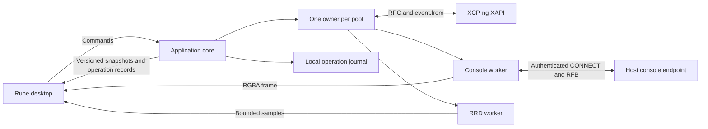

# Architecture

## Initial alpha baseline

The sections below define the target architecture. The initial implementation lives in
the three Cargo workspace members listed below; its current public facade is compiled
Rust in `crates/xenadmin-core/src/lib.rs` and the re-exported types.

- `Backend::connect(ConnectionOptions, Credentials)` returns a `Connection` immediately.
  `watch()` and `latest()` expose immutable snapshots, while `notify_on_change()` wakes Rune.
- A snapshot mints `ObservedVm` only for current inventory. Its private fields bind the VM
  to its pool and a process-wide unique connection generation. `submit(id, VmCommand)` and
  `open_console()` require observations and recheck freshness. `ObservedSnapshot` additionally
  binds a snapshot to its observed parent. Snapshot records have a separate typed inventory
  and parent index; they are not VM/template rows.
- Each connection actor owns inventory and session authority. Separate workers poll mutation
  tasks and decode consoles. The SQLite journal admits conflicting mutations transactionally
  and preserves task references across reconnects. Snapshot task results are durably recorded
  before UUID/parent verification; verification can resume without the original task record. There is currently one connection in the
  UI; core connections resolving to the same pool are not deduplicated yet.
- `xapi.rs` contains a bounded, handwritten decoder for the initial five event classes;
  matching-schema generated bindings and the full device graph remain planned.
- `console.rs` owns an authenticated CONNECT stream, `vnc-rs` decoding, latest RGBA frames,
  and bounded ordered input. `console_view.rs` maps Rune events and presents `Pixels`.
- The alpha has no metrics worker, bulk transfers, keyring storage, or multi-object workflows.
  Malformed event batches fail atomically and require reconnect; automatic resynchronization
  of that fault, remembered-member failover, and backoff jitter remain to be implemented.

The [alpha report](reports/2026-11-07-alpha.md) owns the verification record and remaining
gaps. The [snapshot increment](reports/2026-11-07-snapshots.md) records the newer single-task
VM commands; multi-step deletion, provisioning and settings remain planned. Interface sketches below describe the broader design, not additional shipped APIs.

The later implemented increments are recorded below and in `docs/reports/`; the initial
alpha limitations above are historical rather than a description of every current feature.

## Deployment and ownership

Ship one Linux executable. Rune owns the main thread and its windows. A background Tokio
runtime runs the application core. The core connects directly to XAPI, console endpoints,
RRD endpoints, and later bulk-transfer endpoints. No local HTTP server or resident daemon
is required. The core has no Rune dependency.



Keep these workspace boundaries small:

| Location | Owns |
| --- | --- |
| `crates/xenadmin-core` | Public application types and facade. Private modules for pool ownership, XAPI, operations, console, metrics, and local persistence |
| `crates/xenadmin-desktop` | Rune views, UI state, snapshot adaptation, frame presentation, physical input, and desktop integration |
| `tools/host-probe` | CLI consumer of the core for protocol qualification and lab acceptance |
| `crates/xenadmin-core/tests` | Local controllable HTTP, TLS, and RFB protocol fixtures |

Raw wire records and future generated bindings stay inside the core's private `xapi`
module. A view cannot bypass the application facade.
Avoid separate controller, repository, and service layers that forward the same calls.

## Caller's view

The following is interface notation for design review. It is not compiled Rust and does
not claim existing symbols. The facade hides authentication, event continuity, endpoint
selection, capability checks, task tracking, and reconnect policy.

```text
backend = Backend::start(local_services)
connection = backend.connect(saved_profile)
subscription = connection.watch()
desktop_adapter.attach(subscription, rune_waker)
```

The adapter receives immutable snapshots in background work, wakes Rune, and replaces UI
state on the main thread. It never blocks a Rune callback waiting for a host.

```text
request_id = OperationId::new()
prepared = connection.prepare(Command::StartVm(selected_vm_observation))
operation = connection.submit(request_id, prepared)
operation_panel.observe(operation.watch())
```

Preparation does not imply a confirmation dialog for every action. For force operations,
deletion, or a multi-object workflow, the UI presents the affected resources from the
prepared command before submission. Submission revalidates its preconditions.

```text
console = connection.open_console(selected_vm_observation, Interactive)
desktop_adapter.present(console.frames(), console.input())
console.release_all_input()  // on focus loss
console.close()              // on tab closure
```

## Public types and signatures

Use private constructors for validated endpoints, observed objects, and prepared commands.
Reject invalid external data when it enters the adapter. Keep ordinary domain logic pure.

```text
ConnectionId: local profile identity
PoolId: validated pool UUID
Generation: backend epoch plus monotonically increasing connection generation
ObjectId: PoolId plus object kind plus object UUID
ObservedObject: ObjectId plus Generation plus object revision
InventoryRevision: Generation plus applied event-batch sequence

ConnectionState:
    Disconnected | Connecting | Authenticating | Synchronizing |
    Ready | Reconnecting | AuthenticationRequired | TrustRequired | Failed
Freshness: Current | Stale(last_success, reason) | Synchronizing

OperationState:
    Queued | Dispatching | Tracking | Reconciling | CancellationRequested |
    Succeeded | Failed | Cancelled | PartiallyCompleted | OutcomeUnknown

Backend::start(LocalServices) -> Backend
Backend::connect(ProfileId) async -> ConnectionHandle
Backend::shutdown() async -> ShutdownReport
ConnectionHandle::watch() -> SnapshotWatch<PoolSnapshot>
ConnectionHandle::prepare(Command) async -> PreparedCommand
ConnectionHandle::submit(OperationId, PreparedCommand) async -> OperationHandle
ConnectionHandle::operations() async -> OperationRecords
ConnectionHandle::open_console(ObservedObject, ConsoleMode) async -> ConsoleHandle
OperationHandle::watch() -> OperationWatch
OperationHandle::request_cancel() async -> CancelDisposition
ConsoleHandle::frames() -> FrameWatch
ConsoleHandle::input(ConsoleInput) -> InputAdmission
ConsoleHandle::close() async
```

All fallible signatures return typed errors in implementation. Expected errors include
authentication required, certificate trust required, permission denied, unsupported
capability, stale observation, busy, disconnected, journal unavailable, and protocol error.
Preserve the upstream error code for diagnosis while presenting a useful operator message.
Unknown enum values and added fields cannot crash ordinary inventory decoding.

`ObjectId` is durable application identity. Generation-local opaque XAPI references remain
private. Task and console handles also carry their connection generation. Objects without
a stable UUID remain transient and cannot become durable operation targets. Names are labels.
Known endpoints map to one authenticated pool owner after pool identity is established.

## Pool state and synchronization

One actor owns each pool's inventory, generation, session authority, and operation state.
Workers return tagged results through bounded channels. Workers never mutate inventory.
The UI merges immutable snapshots from different pools at the read boundary.

Maintain VM-to-host, host-to-VM, VM-to-device, and SR-to-VDI indexes alongside record maps.
Update indexes in the same batch as records. Publish only a coherent applied revision.
Cheap shared immutable records avoid copying every record on each UI update. Measure before
choosing a persistent-map crate or more elaborate indexing.

For bootstrap, issue `event.from` with an empty token for the required classes, collect the
initial event-covered inventory, and fetch required non-event classes separately. Publish
Ready after the required records and relationships are available. Continue with the returned
opaque token. Apply a batch and advance its token together under the pool owner.

Qualify the exact bootstrap and non-event ordering in M0. If a batch is malformed, reject
the batch and resynchronize. Never advance past partially applied data. If continuity is
lost, keep the last snapshot visibly stale, build a replacement inventory, then swap it.
Event batches describe current inventory. They are not a durable audit log.

Use independent event, command, heartbeat, console, and transfer budgets. A long poll must
not exhaust command connections. An actor starts asynchronous work and continues receiving
messages while network requests are pending. Coordinator discovery uses remembered members,
bounded backoff with jitter, and endpoint trust checks. Authentication and permission refusal
need a distinct resolution path from transient network failure.

Increment the generation after a superseding connection, login replacement, or full resync.
Accept inventory, heartbeat, and frame results only from the active generation. Preserve late
mutation responses as operation reconciliation evidence, even when they cannot update current
inventory. Discarding a stale read and forgetting a dispatched write are different actions.

## Commands and durable outcomes

The pool owner evaluates eligibility for both UI display and submission. Check freshness,
observed object incarnation, relevant preconditions, supported API capabilities, and known
permissions. The server remains the authority for authorization and current state.
Serialize this client's conflicting mutations by affected object set. Other clients can
still change the same objects, so preflight is never a lock on the infrastructure.

Allocate an operation ID before admission. Store the normalized intention durably before
acknowledging it, then record dispatch before sending a mutation. Repeated submission with
the same ID and same intent returns the existing operation. The same ID with another intent
is an error. This provides local deduplication, not exactly-once XAPI execution.

Use SQLite for the bounded operation journal, with explicit transactions and a verified
durability setting. The journal stores stable targets, dispatch markers, known task references,
step ownership, and observed outcomes. It stores no password, cookie, or session reference.
Storage failure or exhaustion rejects new mutations before dispatch. Retention prunes terminal
history according to a documented policy. Never evict unresolved operations silently.

Prefer qualified asynchronous XAPI methods. Journal a received task reference promptly.
Use event updates where supported and bounded task polling as a fallback. Record terminal
results before any cleanup of client-owned task records. A removed task does not establish
failure or success.

After a response is lost, reconnect and reconcile task identity, target state, and
operation-specific evidence. Do not replay the mutation automatically. Matching object state
alone might not prove that this operation caused it. Preserve OutcomeUnknown and offer
inspection or explicit operator resolution when evidence cannot establish the result.

Resource operations retain a monotonic interruption flag after any uncertain outcome.
An explicit recheck may publish Verifying while reading existing evidence, but this flag
continues to stop the original execution worker and prevents later mutation steps. Late
positive receipts merge into the durable row without reviving that worker. Old journal
records in OutcomeUnknown acquire the flag when decoded.

Cancellation is a request with its own outcome. Closing an observer or cancelling a local
future does not cancel a server task. Multi-step operations record each dispatch and owned
resource. They can finish PartiallyCompleted. Compensation is conditional on resource
ownership and current preconditions. There is no general atomic rollback for XAPI workflows.

## Delivery and backpressure

The initial implementation uses bounded command admission and independent concurrency limits
for each pool. Select the concrete limits during M0 and record them in one policy definition.
Do not expose arbitrary tuning knobs in the UI before measurements justify them.

Inventory batches are applied completely. A latest-value watch can coalesce published
snapshots because each snapshot has a revision and complete readable state. Operation records
remain queryable from the journal even when progress notifications coalesce. A full admission
queue returns Busy before a command is accepted.

Frames keep the latest complete framebuffer. Preserve the order of key and button changes.
If input cannot be accepted, stop the session safely and clear held input rather than lose
a key-up message. Put explicit limits on response bytes, inventory size, decoded framebuffer
dimensions, metrics samples, and transfer buffers. Report capacity refusal visibly.

## Console and metrics adapters

Resolve the VM's current advertised RFB console and resident host. Validate the destination,
open the authenticated HTTP CONNECT tunnel, then negotiate RFB on the resulting stream.
This is a host console tunnel, not the generic HTTP-proxy CONNECT destination format.
Do not assume an HTTP client exposes this upgrade correctly. Qualify the stream in M0.

The RFB component owns decoding, cursor updates, resize negotiation, pointer conversion,
and key negotiation. The desktop adapter alone converts frames into Rune `Pixels` updates.
Use a console-specific generation so replacing a console cannot display delayed old frames.
Reconnect after location/reference changes and release held input on focus loss and closure.
The initial path uses bounded RGBA uploads. Zero-copy GPU integration needs later evidence.

RRD polling has independent scheduling and bounds. Stop unnecessary high-resolution polling
for hidden views. Show unavailable samples as gaps. Management controls remain available
when metrics fail. Bulk imports and exports later use streamed HTTP bodies and operation
tracking, with separate timeout and cancellation policy.

## Local trust and lifecycle

Use normal CA and hostname validation, with explicit custom CA or endpoint-specific trust
for self-signed installations. Bind accepted certificate identity to the endpoint and detect
changes. Apply the same policy to coordinator redirects, consoles, metrics, and transfers.
The user can explicitly disable certificate validation for a connection, including its
coordinator redirects and consoles. This opt-out retains HTTPS and console destination
checks, is remembered with the endpoint, and remains visible in connection status. With
validation enabled, do not forward credentials to an unverified advertised destination.
Support a credential prompt when Secret Service is unavailable or locked. Session-only login keeps the client
usable without a functioning keyring. Redact secrets and sensitive URL parameters from logs.

Certificate inspection uses a separate credential-free TLS handshake. It records the normal
platform/custom-CA verification result while retaining handshake signature verification;
only that inspection can proceed after a certificate validation failure. Normal connections
still enforce their configured CA, exact-endpoint SHA-256 pin or explicit bypass policy.
The editor compares the previous pin, captured form and editor epoch before accepting a
reviewed certificate into its unsaved draft. Accepting never retries login or changes another
endpoint. Version 3 profiles retain bounded certificate summaries and proxy configuration;
versions 1 and 2 continue to load with Environment routing as the default.

Each connection captures environment proxy settings once. Direct, captured Environment and
explicit HTTP CONNECT routes feed both HTTP clients and raw console/inspection sockets;
redirected host endpoints receive the same frozen routing policy. Unsupported proxy schemes
fail rather than falling back to a direct route. Transient Basic proxy credentials bind to
the exact proxy endpoint and username and form part of the pool-owner authority key. They
are never saved with profiles or sent inside the host TLS tunnel. HTTP proxy authentication
itself is not protected by TLS to the proxy; the editor states that boundary. Certificate
pins and host credentials remain scoped to the inner host endpoint.

Each new XAPI session discovers its own local-superuser flag and bounded effective
permission list. The session list is static server evidence; subject role names are display
information and do not grant capabilities. The ordinary RPC boundary checks exact normalized
method permission, removing the asynchronous prefix as XAPI does. A known missing permission
prevents that RPC. Unsupported, denied or invalid discovery remains explicit unknown and
defers authorization to the server. Protected map-key add/remove operations remain unknown
without the server's full protected-key schema. Grants never bypass object-state checks or
server rejection. Connection snapshots expose this evidence only while current and reset it
on every generation, including renewal. No session reference enters the public projection.
Direct HTTP authorization remains enforced by the host; advanced workflow reviews need
complete typed method requirements before they can predict all later dispatch denials.

Closing the desktop stops new admission, journals outstanding state, closes consoles, and
performs bounded local cleanup and logout where safe. Explain that server tasks may continue.
On restart, reconcile unfinished journal entries after fresh pool inventory is available.
The first release accepts that a desktop crash also stops local polling. A separate service
can be reconsidered if persistent unattended operation becomes a requirement.


## Implemented parity foundations

Saved profiles live in a versioned private `profiles.json`. The migration from the original
single-endpoint preferences runs once and stores no passwords. Secret Service items bind to
profile UUID, endpoint and username; session-only credentials remain the default. A retained
OS file lock gives one mutating desktop ownership of a state directory. A second desktop
cannot migrate/write profiles, preferences or the operation journal.

Profile document version 2 adds explicit per-profile `auto_connect`, valid only with Secret
Service credential mode. Version 1 documents default it to false. Startup queues opted-in
profiles once, after the Rune waker is installed. Bulk connection and startup restoration share
a four-slot credential queue. Each lookup carries its own attempt UUID and saved profile;
completion validates both before connecting. Editor loads also compare the current form.
Changing or removing a profile, cancelling its attempt, or disconnecting all invalidates late
results. Keyring failures remain per-profile manual recovery states and are not retried by polling.

Each Backend authenticates an incoming profile before resolving its pool. An in-memory pool
registry then compares credentials, access mode and trust policy. Equivalent profiles share
the canonical inventory generation, request path and operation history. Different authority
contexts require an explicit disconnect/reconnect. Dropping one Connection handle does not
disconnect other handles; explicit disconnect closes the logical pool connection. Profiles
persist discovered member endpoints with the expected pool UUID, which is checked before
publishing Ready after fallback. Concurrent pools have independent owners.

Optional inventory classes carry explicit unavailable/permission/invalid states. Missing
metrics never become zero-valued samples. Typed UUID relationships join VDI/VBD, VIF/network,
PIF/bond/VLAN and PBD/SR/host records without exposing opaque session references to Rune.
A bounded diagnostic request reads current VM state and asks XAPI to validate a power action;
this is advisory and never substitutes for server enforcement during the actual action.

The journal's version 2 migration retains legacy operations and task references and refuses
future versions. Settings edits persist Preparing, Dispatching and Verifying boundaries plus
per-field results. A lost write response or failed post-write verification remains unresolved;
a failure before a later write records partial completion. Rechecking reads desired values
and never repeats a setter. Shared maps merge one reviewed key into the freshly read map.
Other operators can still race the XAPI setter; XAPI offers no compare-and-swap transaction
for these map setters. Device and chosen-host commands reserve their explicitly selected
resources, preflight fresh identities/ownership, then dispatch once through tracked tasks.

Resource administration adds typed pool, host, SR and network observations and commands.
Journal version 3 retains VM evidence and adds a revisioned resource-operation table in the
same database. Transactional admission excludes overlapping VM and administration writes
within a pool while an administration outcome is unresolved. Resource operations preserve
their target identities, prior-value checks, ordered steps and created identities. A fresh
read precedes each setter. Reconciliation inspects dispatched changes and never completes
unsubmitted steps. Network creation uses an operation tag plus a bounded pre-existing UUID
baseline; deletion and MTU changes require fresh empty PIF/VIF sets. Resource history is
available from the pool dialog even after the target is removed, and from the private inspector.

The [console adapter decision](decisions/0003-console-protocol-adapter.md) documents the
vendored protocol fixes. Console target identity is independent of table selection. Clipboard
requests are explicit and fenced by a console epoch, including reconnection; passwords and
clipboard content are never part of the operation journal.

Snapshot deletion binds the review to selected disk UUIDs. The journal persists its plan and
each checkpoint-memory, snapshot-record and disk-deletion dispatch. Clone operations persist
a bounded pre-existing UUID baseline before submission, retain the resulting new UUID and
journal template conversion separately. Recovery verifies existing outcomes without submitting
new conversion or deletion writes. A lost reply cannot be interpreted as successful cleanup.

Development inspection is an explicitly enabled, read-only Unix socket inside the desktop
process. The desktop registers its existing connection handles; the service does not own a
second host login. Requests use typed projections of public snapshots and operation records,
with captured freshness context and no raw RPC facility. Same-user ownership and peer checks,
bounded messages, concurrency limits and deadlines protect this private development boundary.
The application instance lock owns startup, and socket cleanup verifies inode identity.
Normal launches do not enable inspection; `scripts/dev.sh` does. See
[development diagnostics](DEVELOPMENT.md) for protocol consumers.

The Activity workspace observes typed task/message UUIDs through the same pool/generation
boundary as other resource commands. Reviewed message dismissal carries a digest of the
public content and never journals the body. Task cancellation has a narrow journal-admission
exception: it reserves its task identity while leaving the original mutation and its
reservations untouched. The observer never destroys another operation's task and distinguishes
request acceptance from the task's eventual outcome. Recovery only reads existing evidence.
Activity exports explicitly project public fields rather than serializing operation records,
whose private workflow plans can contain reconciliation references. Native Save captures an
immutable selection; bounded serialization and private atomic writes run off the UI thread.
Local hiding applies only to terminal history entries and never removes journal evidence.
See the [activity verification report](reports/2026-11-08-activity.md).

Same-pool migration captures an immutable VM/device placement review. A durable private plan
stores the pre-dispatch graph and bounded VDI identity baseline; receiver session tokens stay
only in transient dispatch memory. The shared task tracker records migration once and verifies
VM/VBD/VIF continuity plus replacement disk UUIDs. A halted move journals home-host assignment
as a separate step. Read-only recovery consumes persisted task completion without replaying
migration or assignment. Console follow consumes verified local migration outcomes only after
matching destination inventory arrives, scoped to the console's original pool/VM identity.

Storage lifecycle uses the resource journal and pool admission guard with typed SR/PBD targets.
Each command dispatches one asynchronous XAPI mutation, including fixed trim plugin calls;
creating a PBD and plugging it are separate reviewed commands. Creation saves a bounded UUID
baseline, private task/result references and verified public created UUID. Missing task/result
identity stays unknown; the client never replays provisioning. A saved creation result can be
verified after the server task disappears. Forget and destroy have different reviews and require
fresh disk, attachment and pool/host dependency checks. Authentication values use a dedicated transient facade; public commands and records contain
only authentication kind and Secret UUID evidence. See the authenticated storage increment below.
Read-only storage discovery reuses the authenticated connection, is cancelled on generation
change or handle drop, and projects bounded capability metadata and SR UUID/name/size records.
The desktop never receives raw probe XML, RPC references or PBD device-config credentials.
Guided discovery recognizes only stage-specific missing-parameter XML errors inside the XAPI
adapter. Typed results remain bound to captured host, pool generation and form inputs;
selecting a discovered alternate portal is explicit and never provisions storage. Custom
iSCSI ports are preserved, with old intents defaulting to 3260. See the [discovery report](reports/2026-11-08-storage-discovery.md).


## Pool administration increment

`ResourceAction::Pool(PoolOperation)` carries closed typed policy, HA, handover,
member-ejection and pool-security intents. Commands target an observed pool and
embed typed member/VM/SR UUIDs. The existing pool-wide journal admission guard
serializes them with other resource and VM writes. `PoolAdministration` keeps
missing capability/status fields unknown, including empty versus absent VM HA
priority values.

Fresh reads and read-only XAPI assertions check policy conflicts, coordinator
identity, host liveness, HA state, heartbeat eligibility and attachment coverage,
VM agility and member dependencies immediately before dispatch. The client never
automatically reduces HA, disables hosts, evacuates guests or shuts them down as
part of a pool command. These are separate reviewed workflows.

Pool operations persist a monotonic completion receipt after a synchronous reply
or a successful asynchronous task, before verifying final state. A lost task
identity, failed/cancelled pool task or partial pool RPC failure stays unknown and
retains the reservation; a matching field alone cannot prove async completion.
Recovery only polls or verifies saved evidence. It never replays pool mutations.
TLS verification here is host-to-host pool policy, independent of desktop trust.
No pool authentication secrets are read or included in history.
Host administration uses a typed operation nested in the existing resource journal. Each
step persists dispatch, accepted response and task-success evidence independently. Fresh
identity, guest membership, prerequisite and previous-value checks precede every mutation.
Maintenance failures retain completed changes; no automatic re-enable, guest shutdown,
HA reduction or coordinator handover runs. Recovery reads existing task/object evidence
without submitting remaining steps. A newer boot/toolstack marker can establish restart;
an offline host alone cannot establish a lost shutdown request. Stopping the workflow only
prevents later steps after in-flight work resolves. Private receipt merging preserves
cancellation and never resurrects an acknowledged operation. See the
[host administration report](reports/2026-11-08-host-administration.md).
Archive transfer is a typed resource-journal workflow, with paths and local inode identity in a private plan. Authentication is transient HTTP Cookie data; public history, export and inspection projections contain only action/progress/result UUIDs. Fixed GET/PUT endpoints stream bounded buffers under the established trust policy. Uploads are never replayed, and manual download redirects are confined to fresh pool hosts and fixed operation parameters. Local stream completion and host-task completion are separate persisted proofs. Export publishes an owned private file atomically without replacement. Failed imports retain the pool reservation because server creation can precede provenance tagging; known UUIDs are evidence for explicit inspection, never permission for automatic deletion. See the [XVA transfer report](reports/2026-11-08-xva-transfers.md).

Public VM operation serialization excludes reconciliation references, private workflow plans,
clone baselines and cancellation-dispatch evidence. The journal alone encodes and decodes
these fields under their existing flat payload keys; its separate task column remains
authoritative. Loading, history, recovery and admission share this decoder, and malformed
private evidence fails closed rather than being silently discarded. Public created-object
UUIDs and operation outcomes remain available to consumers.

The vApp manager submits typed pool-scoped resource commands. Group power reviews capture exact
member UUIDs, state, order and delays; fresh backend checks bind each VM to the group before
submitting one server-side operation. Creation baselines and asynchronous completion receipts
are monotonic journal evidence. Failed/cancelled group tasks and mismatched child outcomes keep
the pool reserved for inspection; recovery never repeats the power action. Membership removal
and empty-group deletion preserve VMs and disks. See the [vApp report](reports/2026-11-08-vapps.md).


## Transient pool security inputs

`PoolSecurityOperation` is durable safe intent; `PoolSensitiveChange` and
`ServerCertificate` are nonserializable transient inputs attached only to the queued
worker. The latter validates bounded PEM and a matching unencrypted PKCS8 key.
Directory credentials and key material are injected into private RPC arguments only
after fresh checks and are never stored in the operation record or database.
Security writes share the pool admission/receipt rules above; restart cannot replay
a command or recover credentials. Read-only `inspect_pool_security` returns bounded
typed subject/role/member/certificate projections with generation and drop
cancellation, a 45-second deadline and the shared discovery-worker limit.
See the [security increment report](reports/2026-11-08-pool-security.md) for supported
flows and the local-superuser/reconnect limitations.
Disk-image transfer extends the same private plan with a bounded pre-existing VDI baseline, operation ownership marker, creation reference and verified UUID. Every import creates a new unattached VDI, journals intent before `VDI.create`, then sends bytes only once to the fixed raw-VDI endpoint. A lost creation reply can recover the disk identity but never starts the upload during reconciliation. Failed/cancelled image uploads can finish as partial with that exact disk retained; unlike XVA import, this endpoint creates no VM or network records. Format checks validate raw sector length or a complete fixed/dynamic VHD, including bounded BAT ranges and overlap refusal. Export rejects live consumers and rechecks source identity, storage and capacity before atomic publication. See the [disk-image transfer report](reports/2026-11-08-disk-image-transfers.md).
VMSS schedules are host-side typed resource operations with private creation/run baselines
and completion receipts. A dedicated read-only query captures the coordinator’s clock and
execution contract; desktop scheduling is never substituted. Exact membership, task/plugin
proof and per-VM snapshot read-back constrain success. See the [snapshot schedule report](reports/2026-11-08-snapshot-schedules.md).

## Joining independently connected pools

`Connection::join_pool(id, PoolJoinSelection, destination, Credentials)` captures both pool
observations, the source host and destination coordinator. The credentials are transient;
only a closed `PoolOperation::Join` intent, destination host UUID baseline and monotonic
completion receipt enter the resource journal. The ordinary resource submission path
rejects join intents that bypass this facade. Both connections must be writable and owned
by the same backend; temporary credential validation uses the destination's existing
endpoint and certificate policy and refuses coordinator redirects.

Join reserves both pools in the same SQLite admission transaction. VM and resource writes
consult the typed scopes in a bounded active-row scan; malformed active records fail
closed. History and controls recognize either pool, while read-only join reconciliation
routes to the destination. A recorded synchronous reply and fresh exact membership are
both required for success. Lost replies, interrupted source identity transitions and
later topology changes remain unknown; the worker never replays join. The destination
connection's generation and lifetime fence preflight and verification without keeping
a dropped connection alive.

The review explicitly separates desktop trust from XAPI's initial host-to-host certificate
bootstrap. Joining does not silently change saved profiles, pins, HA, guest power or
network/storage prerequisites. See the [join report](reports/2026-11-08-pool-join.md) for
qualification boundaries and primary protocol evidence.

## Snapshot metadata and restore orchestration

The typed snapshot workflow owns creation metadata, existing-snapshot metadata edits, and
reviewed shutdown/revert/start-or-resume steps. Its private plan stores immutable target and
baseline identities plus monotonic task receipts/completion evidence. The normal VM journal
reserves the parent and selected snapshot; public serialization omits reconciliation internals.
A dedicated evidence merge preserves recovery/acknowledgment controls when a late response
arrives, and a fresh per-step revision check prevents dispatch after recovery. Reconciliation
is read-only and does not continue pending power or metadata steps. See the
[snapshot workflow report](reports/2026-11-08-snapshot-workflows.md) for scope and verification.


OVF/OVA adds a bounded descriptor/package parser and typed guest plan rather than
passing arbitrary extension maps into XAPI. Per-resource creation baselines and
ownership markers are persisted before each write; raw references and local member
ranges remain in the private transfer plan. OVA member streams are bounded to their
reviewed offset/length. Each disk leg has separate stream/task evidence, and recovery
never continues unsubmitted changes. Export captures a fresh guest/device graph,
streams stable disks into an owned mode-0700 staging directory, validates a generated
descriptor and integrity manifest, and publishes a new file or directory atomically
without replacement. See the [OVF/OVA transfer report](reports/2026-11-08-ovf-ova-transfers.md)
for the supported ordinary-guest subset and remaining interoperability gaps.
## Cross-pool search

`InventorySearch` is a pure typed projection/filter over immutable inventories. Search
results carry pool UUID plus typed object identity. The desktop coalesces connected profile
aliases by pool, preferring current and selected profiles, and labels stale/partial coverage.
Opening a result rechecks the live pool and exact object/parent before selecting a view.
Versioned `SearchCatalog` files contain filters only; imports are bounded and reviewed,
conflicts do not overwrite local definitions, and native callbacks are scoped to a workspace.
See [verification and remaining work](reports/2026-11-08-cross-pool-search.md).

Bulk VM power actions use one pool-scoped resource command with at most 32 captured guest
UUID/state pairs. Whole-selection preflight precedes serial fresh checks and a per-item
persist-before-dispatch CAS. The private immutable plan keeps monotonic dispatch/task/success/
verification evidence; recovery checks sent work only and never submits pending items.
A user stop finishes the current task and skips the rest without calling task.cancel. Late
receipts preserve recovered unknown or acknowledged state. See the
[bulk power backend report](reports/2026-11-08-bulk-power-backend.md).


## Cross-pool VM transfers

`CrossPoolVmSelection` captures current source and destination observations, exact disk/NIC
mappings and an explicit host-transport review. The resource journal reserves both pools;
its private `cross_pool_plan` persists bounded identity baselines, graph/shape and monotonic
receipts, while receiver session credentials remain transient. Destination identities are
verified independently before source disposition, retaining partial resources in public
history. Recovery reads the original evidence with both current connections and never
replays receiver preparation or transfer. The original worker stops after recovered unknown
state even if a late positive receipt arrives. Public Activity exports include the destination
pool so UUIDs are unambiguous. See the [cross-pool report](reports/2026-11-08-cross-pool-transfers.md)
for the supported subset, host-to-host transport policy and qualification gaps.

## Authenticated storage credentials

`StorageCredentials` is nonserializable and zeroizes its input strings on drop. The dedicated
submission facade binds it to an observed pool/SR and a closed CHAP, mutual CHAP or SMB3
operation. The resource journal persists private immutable storage/Secret baselines, username
digests and monotonic dispatch/receipt/cleanup evidence, never credential values or Secret
opaque references. Public history and development inspection expose only bootstrap Secret UUIDs
and cleanup state. Active admission uses the full private-plan decoder and fails closed on corruption.

The worker creates operation-tagged temporary `secret` objects, provisions through one saved
async task, then verifies the new SR/PBD graph and fresh attachment-owned Secret copies. XAPI
ignores `PBD.create.other_config`; verification therefore relies on task/result receipt, new UUID
baseline, exact host/SR/configuration and credential-copy identities. Cleanup deletes only owned
bootstrap Secrets after verified task completion and a fresh bounded PBD/SR consumer scan.
Uncertain provisioning retains evidence; explicit cleanup requires source-row provenance and
proof that provisioning cannot still be running. Recovery reads existing evidence and never
continues pending provisioning or deletion. See the [verification report](reports/2026-11-08-authenticated-storage.md).

## Secondary network interfaces

Typed network commands add IPv6 configuration, secondary-interface purpose labels and
unplug protection. Each command captures PIF UUID, host/network identity and prior settings;
fresh reads refuse changed identities, unmanaged interfaces and bond members. IPv6 changes
also require an already enabled management IPv6 mode on that host, preserving the installed
address family. Shared DNS behavior is explicit in the review. Purpose changes merge one
key into the current map; protection remains a separate intention. These commands use the
existing asynchronous task journal and never replay a lost submission. Management interface
handover and topology migration remain separate pending workflows. See the
[verification report](reports/2026-11-08-network-interfaces.md).

## Host power-on credentials

`HostPowerConfiguration` projects only recognized disabled, Wake-on-LAN and IPMI settings.
`configure_host_power` accepts a non-serializable password separately from captured settings.
Its private plan stores immutable baseline UUIDs and monotonic Secret/setter receipts; public
history exposes only Secret identity. Unknown setting responses never become successful from
matching fields alone, and an interrupted original worker cannot continue after a recheck.
Explicit cleanup requires original-operation provenance, no unresolved setter and fresh host/
storage consumer checks. See the [host power credential report](reports/2026-11-08-host-power-credentials.md)
for the XCP-ng package evidence, source semantics and validation limits.

### Pool root password changes

A root-password action captures the pool coordinator and complete member UUID set. Its
password is transient and zeroizing; the journal retains only dispatch, completion,
coordinator-login and reconnect-credential evidence. XCP-ng changes local root on the
coordinator and requests best-effort member synchronization, so multi-member results
remain partial with the other member UUIDs explicitly unverified. A missing completion
receipt never triggers another password change or an assumed credential replacement.

After a recorded change and an exact-endpoint coordinator login, the connection actor
validates the generation and journal proof under a SQLite immediate transaction, rekeys
its pool-owner authority and replaces its in-memory reconnect credential. Old-password
aliases are cancelled, without cancelling the canonical connection. Recovery and
acknowledgement cannot enter between the durable proof check and local replacement.
The desktop can update an existing saved root password only after positive, uninterrupted
completion, with an unchanged captured profile and explicit opt-in. Unknown/acknowledged
results, stale profiles, closed views and keyring failures never assume or replay a save.

## Snapshot inspection

Snapshot ancestry is a typed UUID graph separate from the owning VM relationship. A bounded, generation-fenced read query resolves the exact pool/VM/snapshot and retrieves only the known saved-preview association through the current trust/proxy policy. Image bytes stay out of serialized inventory, journals and inspector output; the desktop decodes them off-thread with image dimension/allocation limits. See the [snapshot inspection evidence](reports/2026-11-08-snapshot-inspection.md).

## Permission review requirements

`PermissionRequirements` represents write methods provable from an immutable captured
change. VM settings and device properties derive them from the same step plans used for
dispatch; host administration shares step selection and method mapping. Storage, network
and pool administration reuse typed dispatch methods. A known denial blocks confirmation
and the worker before its first write; the generic resource worker also checks its complete
freshly prepared method set. Unknown protected-key, conditional and HTTP requirements do
not establish authority. Every individual RPC still uses its current session guard, and
fresh identity/capability/state checks remain independent prerequisites. See the
[implementation report](reports/2026-11-08-permission-reviews.md) for covered dialogs and
retained dedicated workflow maps.


## Guest tools media

`DeviceOperation::MountGuestTools` captures the VM observation, exact CD drive, tools VDI,
ISO SR and optional prior VDI. The durable device lifecycle executes separate eject/insert
steps; both steps re-resolve the VM/CD/media identities and storage reachability. A failed
insert can leave the reviewed drive empty. Reconciliation reads postconditions and never
replays either write or automatically remounts old media. The UI holds its captured pool/VM
review across selection changes and reports the tracked operation. Guest installation is
performed inside the guest; mounting media does not establish that tools were installed.

## Management networking recovery

Management changes capture exact interface configuration in a typed intent and privately
persist the reviewed recovery endpoint, unique host certificate and task evidence. Candidate
registration is pool/generation scoped and adds no certificate trust. An isolated recovery
login composes the connection's TLS verifier with a first-hop host-leaf identity constraint;
coordinator redirects continue under the ordinary trust/proxy policy. Configuration readback
and authenticated host-route verification remain separate public evidence. The owner can
try the registered candidate after normal transport failure, without deliberately restarting
other workspaces. Unknown outcomes retain the pool guard and reconciliation never replays
the management call. The [management report](reports/2026-11-08-management-network.md) records
the qualified subset, evidence and remaining handover workflows.

## Creation with a cloud-init configuration drive

The creation wizard's optional NoCloud draft is transient UI state, separate from the
serialized creation command and operation journal. Submission returns its admitted operation
ID. The continuation captures that ID, the pool/source observation and immutable creation
operation; only its successful verified new-VM result can open the existing private media
workflow. The original generation, exact new halted ordinary VM and chosen SR must still
match. Failed/unknown/acknowledged results cannot continue automatically. The configuration
drive is separately reviewed and tracked, and neither stage starts the guest. Closing the
wizard discards the draft without cancelling host creation. See the
[creation cloud-init report](reports/2026-11-08-creation-cloud-init.md).

## VM recovery controls

Typed `VmRecoveryOperation` commands preserve normal VM/pool reservation admission. Force
recovery binds the captured Running VM and task UUID set, preserves administrative blocks
and invokes fresh host validity checks without cancelling other clients' tasks. HVM
recovery boot owns a temporary order-only change, single startup and exact guarded
restoration. Its private plan stores immutable step shape/task baseline and monotonic
receipts; public step status is validated against that evidence. Recovery is read-only.
Separate restoration requires a positive original setter receipt, an unsubmitted original
restore and an unused source claim. See the [recovery report](reports/2026-11-08-vm-recovery.md).
Automatic management addressing adds a typed DHCP/IPv6 autoconfiguration intent with a reviewed recovery IP. The recovery IP is not sent as static configuration: XAPI receives blank address/gateway arguments for automatic modes. Completion requires the observed mode, actual assigned IP, unchanged secondary-family settings, exact host address and the existing host-bound authenticated recovery route. Dynamic assignments that differ from review remain unresolved; no discovery scan, DNS update or configuration replay is implied. See the [address transition report](reports/2026-11-08-management-address-transitions.md).

Host recovery staging uses the existing pool-scoped transfer reservation and owned server task.
The selected gzip-tar archive is inspected without extraction, bound to exact host UUID, product
version, file identity and compressed SHA-256, then revalidated before task creation. The archive
inventory must contain only known literal assignments because the target restore script sources
it; the complete path/link graph and post-extraction marker are checked before upload. This is
structural validation of a trusted backup, not proof that arbitrary archived system files are safe.
Host archive HTTP composes a fresh, unique pool-host certificate identity with the existing
CA/pin/skip and proxy policy, rejects redirects, and sends the session only as a cookie. Staging
reformats the live host's configured backup partition; the API does not expose its device path.
A complete stream receipt with matching digest and owned-task success establishes staging only.
Lost/failing/cancelled uploads remain uncertain and are never replayed. Recovery and acknowledgement
are preserved when late stream evidence arrives; explicit recheck reads the saved task only.
## Performance alarm configuration

Typed alarm settings project bounded host perfmon XML and pool email keys without exposing raw definitions or unrelated SMTP credentials. Each reviewed setter re-resolves exact identity and settings revision, merges the latest unrelated metadata, and verifies the requested postcondition. Separate fixed-plugin refresh operations retain monotonic host-bound positive receipts; missing responses cannot be replayed or inferred from saved configuration. The [alarm report](reports/2026-11-08-performance-alarms.md) records the whole-map concurrency limit and configuration/service/delivery distinction.
Existing management VLAN/bond endpoints carry a bounded typed component in the reviewed interface. Fresh XAPI discovery checks forward/reverse references before inventory projection, then compares captured members, tags, identity, protection and configuration. Endpoint IP/management fields are validated separately against the same raw PIF observations, including automatic assignments. Runtime link counters are excluded. Legacy journal captures without topology retain the original physical-interface restrictions. The existing single-task worker and certificate-bound recovery path remain shared; see the [existing topology report](reports/2026-11-08-management-existing-topology.md).

### Retained host crashdump deletion

`DeleteHostCrashdump` captures a current host observation and typed crashdump UUID/time/size.
Its private immutable plan joins the resource journal and pool-wide mutation reservation.
Dispatch is persisted before the synchronous host call; a separate monotonic completion receipt
is merged without reviving interrupted or acknowledged work. Reconciliation requires that
receipt before accepting record absence. The host implementation destroys its database record
in a finally block, so API failure or disappearance alone cannot prove successful deletion.
The host's internal filename is not a public API field and is never exposed or fabricated by
the client. See the [source/verification report](reports/2026-11-08-host-crashdump-deletion.md).


## Virtual disk administration

`ResourceTarget::Disk` and typed `DiskOperation` reviews bind a VDI's UUID, SR, size and ordinary VM attachment identities to the existing pool/generation observation. The private disk plan captures task/disk UUID baselines and monotonic completion evidence. It is excluded from public serde and explicitly encoded in the private journal; load/save/admission validate the public action and step shape against the plan. Recovery reads only dispatched steps and never replays writes.

Disk cleanup derives ownership from terminal durable creation evidence, checking an original marker where that workflow uses one. A separate fresh graph check refuses every attachment, suspend-image, snapshot-parent and HA dependency. A new detached copy's returned UUID is published only after the task receipt, new-identity baseline and complete disk graph verify. Local stop prevents remaining steps without claiming server I/O was cancelled. See the [disk increment report](reports/2026-11-08-disk-administration.md) for supported boundaries and verification.
Management bond creation/removal extends the same single-task management worker and certificate-bound recovery route. Typed intents capture source/members/target and a private immutable Bond/PIF baseline; positive created identities are monotonic evidence independent of eventual configuration success. Source configuration moves inside XAPI, so uncertain outcomes never trigger client rollback or replay. The initial static IPv4 workflow refuses unreviewed VLAN, VM, clustering and service dependencies; see the [bond migration report](reports/2026-11-08-management-bond-migration.md).

Snapshot preview capture is a bounded, opt-in desktop pipeline holding one private in-memory image and the original VM observation. A second typed resource operation can upload only after local snapshot-creation provenance and current snapshot identity match. Its private plan captures existing blob UUIDs, a positive creation reference, exact new UUID, dispatch evidence and image hash; readback proves content because the host acknowledges PUT early. Recovery never creates or uploads again. See the [capture report](reports/2026-11-08-snapshot-preview-capture.md).

## Storage maintenance

`StorageMaintenance` binds an existing SR to selected host/PBD UUIDs or a captured read-cache override. Repair freezes the coordinator-first order and a private fingerprint of each attachment configuration; it never copies credentials or creates PBDs. Each dispatch re-resolves the reviewed graph and relevant permissions. Private task UUID baselines and receipts prevent matching attachment state from proving a missing response. Late evidence preserves recovery/acknowledgement; explicit recheck inspects submitted steps and never submits remaining hosts.

Read-cache edits use only `SR.remove_from_other_config` / `add_to_other_config` for `o_direct`, preserving unrelated metadata. Eligibility requires an advertised `VDI_READ_CACHING` feature on a supported file-backed driver. The UI separates policy from effective caching and driver provisioning. The private plan is excluded from public serde, explicitly persisted, immutable after preparation, and validated against public action/steps on load, admission and save. See the [storage maintenance report](reports/2026-11-08-storage-maintenance.md).
