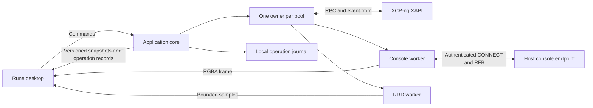

# Architecture

## Initial alpha baseline

The sections below define the target architecture. The initial implementation lives in
the three Cargo workspace members listed below; its current public facade is compiled
Rust in `crates/xenadmin-core/src/lib.rs` and the re-exported types.

- `Backend::connect(ConnectionOptions, Credentials)` returns a `Connection` immediately.
  `watch()` and `latest()` expose immutable snapshots, while `notify_on_change()` wakes Rune.
- A snapshot mints `ObservedVm` only for current inventory. Its private fields bind the VM
  to its pool and a process-wide unique connection generation. `submit(id, VmCommand)` and
  `open_console()` require observations and recheck freshness. `ObservedSnapshot` additionally
  binds a snapshot to its observed parent. Snapshot records have a separate typed inventory
  and parent index; they are not VM/template rows.
- Each connection actor owns inventory and session authority. Separate workers poll mutation
  tasks and decode consoles. The SQLite journal admits conflicting mutations transactionally
  and preserves task references across reconnects. Snapshot task results are durably recorded
  before UUID/parent verification; verification can resume without the original task record. There is currently one connection in the
  UI; core connections resolving to the same pool are not deduplicated yet.
- `xapi.rs` contains a bounded, handwritten decoder for the initial five event classes;
  matching-schema generated bindings and the full device graph remain planned.
- `console.rs` owns an authenticated CONNECT stream, `vnc-rs` decoding, latest RGBA frames,
  and bounded ordered input. `console_view.rs` maps Rune events and presents `Pixels`.
- The alpha has no metrics worker, bulk transfers, keyring storage, or multi-object workflows.
  Malformed event batches fail atomically and require reconnect; automatic resynchronization
  of that fault, remembered-member failover, and backoff jitter remain to be implemented.

The [alpha report](reports/2026-11-07-alpha.md) owns the verification record and remaining
gaps. The [snapshot increment](reports/2026-11-07-snapshots.md) records the newer single-task
VM commands; multi-step deletion, provisioning and settings remain planned. Interface sketches below describe the broader design, not additional shipped APIs.

The later implemented increments are recorded below and in `docs/reports/`; the initial
alpha limitations above are historical rather than a description of every current feature.

## Deployment and ownership

Ship one Linux executable. Rune owns the main thread and its windows. A background Tokio
runtime runs the application core. The core connects directly to XAPI, console endpoints,
RRD endpoints, and later bulk-transfer endpoints. No local HTTP server or resident daemon
is required. The core has no Rune dependency.



Keep these workspace boundaries small:

| Location | Owns |
| --- | --- |
| `crates/xenadmin-core` | Public application types and facade. Private modules for pool ownership, XAPI, operations, console, metrics, and local persistence |
| `crates/xenadmin-desktop` | Rune views, UI state, snapshot adaptation, frame presentation, physical input, and desktop integration |
| `tools/host-probe` | CLI consumer of the core for protocol qualification and lab acceptance |
| `crates/xenadmin-core/tests` | Local controllable HTTP, TLS, and RFB protocol fixtures |

Raw wire records and future generated bindings stay inside the core's private `xapi`
module. A view cannot bypass the application facade.
Avoid separate controller, repository, and service layers that forward the same calls.

## Caller's view

The following is interface notation for design review. It is not compiled Rust and does
not claim existing symbols. The facade hides authentication, event continuity, endpoint
selection, capability checks, task tracking, and reconnect policy.

```text
backend = Backend::start(local_services)
connection = backend.connect(saved_profile)
subscription = connection.watch()
desktop_adapter.attach(subscription, rune_waker)
```

The adapter receives immutable snapshots in background work, wakes Rune, and replaces UI
state on the main thread. It never blocks a Rune callback waiting for a host.

```text
request_id = OperationId::new()
prepared = connection.prepare(Command::StartVm(selected_vm_observation))
operation = connection.submit(request_id, prepared)
operation_panel.observe(operation.watch())
```

Preparation does not imply a confirmation dialog for every action. For force operations,
deletion, or a multi-object workflow, the UI presents the affected resources from the
prepared command before submission. Submission revalidates its preconditions.

```text
console = connection.open_console(selected_vm_observation, Interactive)
desktop_adapter.present(console.frames(), console.input())
console.release_all_input()  // on focus loss
console.close()              // on tab closure
```

## Public types and signatures

Use private constructors for validated endpoints, observed objects, and prepared commands.
Reject invalid external data when it enters the adapter. Keep ordinary domain logic pure.

```text
ConnectionId: local profile identity
PoolId: validated pool UUID
Generation: backend epoch plus monotonically increasing connection generation
ObjectId: PoolId plus object kind plus object UUID
ObservedObject: ObjectId plus Generation plus object revision
InventoryRevision: Generation plus applied event-batch sequence

ConnectionState:
    Disconnected | Connecting | Authenticating | Synchronizing |
    Ready | Reconnecting | AuthenticationRequired | TrustRequired | Failed
Freshness: Current | Stale(last_success, reason) | Synchronizing

OperationState:
    Queued | Dispatching | Tracking | Reconciling | CancellationRequested |
    Succeeded | Failed | Cancelled | PartiallyCompleted | OutcomeUnknown

Backend::start(LocalServices) -> Backend
Backend::connect(ProfileId) async -> ConnectionHandle
Backend::shutdown() async -> ShutdownReport
ConnectionHandle::watch() -> SnapshotWatch<PoolSnapshot>
ConnectionHandle::prepare(Command) async -> PreparedCommand
ConnectionHandle::submit(OperationId, PreparedCommand) async -> OperationHandle
ConnectionHandle::operations() async -> OperationRecords
ConnectionHandle::open_console(ObservedObject, ConsoleMode) async -> ConsoleHandle
OperationHandle::watch() -> OperationWatch
OperationHandle::request_cancel() async -> CancelDisposition
ConsoleHandle::frames() -> FrameWatch
ConsoleHandle::input(ConsoleInput) -> InputAdmission
ConsoleHandle::close() async
```

All fallible signatures return typed errors in implementation. Expected errors include
authentication required, certificate trust required, permission denied, unsupported
capability, stale observation, busy, disconnected, journal unavailable, and protocol error.
Preserve the upstream error code for diagnosis while presenting a useful operator message.
Unknown enum values and added fields cannot crash ordinary inventory decoding.

`ObjectId` is durable application identity. Generation-local opaque XAPI references remain
private. Task and console handles also carry their connection generation. Objects without
a stable UUID remain transient and cannot become durable operation targets. Names are labels.
Known endpoints map to one authenticated pool owner after pool identity is established.

## Pool state and synchronization

One actor owns each pool's inventory, generation, session authority, and operation state.
Workers return tagged results through bounded channels. Workers never mutate inventory.
The UI merges immutable snapshots from different pools at the read boundary.

Maintain VM-to-host, host-to-VM, VM-to-device, and SR-to-VDI indexes alongside record maps.
Update indexes in the same batch as records. Publish only a coherent applied revision.
Cheap shared immutable records avoid copying every record on each UI update. Measure before
choosing a persistent-map crate or more elaborate indexing.

For bootstrap, issue `event.from` with an empty token for the required classes, collect the
initial event-covered inventory, and fetch required non-event classes separately. Publish
Ready after the required records and relationships are available. Continue with the returned
opaque token. Apply a batch and advance its token together under the pool owner.

Qualify the exact bootstrap and non-event ordering in M0. If a batch is malformed, reject
the batch and resynchronize. Never advance past partially applied data. If continuity is
lost, keep the last snapshot visibly stale, build a replacement inventory, then swap it.
Event batches describe current inventory. They are not a durable audit log.

Use independent event, command, heartbeat, console, and transfer budgets. A long poll must
not exhaust command connections. An actor starts asynchronous work and continues receiving
messages while network requests are pending. Coordinator discovery uses remembered members,
bounded backoff with jitter, and endpoint trust checks. Authentication and permission refusal
need a distinct resolution path from transient network failure.

Increment the generation after a superseding connection, login replacement, or full resync.
Accept inventory, heartbeat, and frame results only from the active generation. Preserve late
mutation responses as operation reconciliation evidence, even when they cannot update current
inventory. Discarding a stale read and forgetting a dispatched write are different actions.

## Commands and durable outcomes

The pool owner evaluates eligibility for both UI display and submission. Check freshness,
observed object incarnation, relevant preconditions, supported API capabilities, and known
permissions. The server remains the authority for authorization and current state.
Serialize this client's conflicting mutations by affected object set. Other clients can
still change the same objects, so preflight is never a lock on the infrastructure.

Allocate an operation ID before admission. Store the normalized intention durably before
acknowledging it, then record dispatch before sending a mutation. Repeated submission with
the same ID and same intent returns the existing operation. The same ID with another intent
is an error. This provides local deduplication, not exactly-once XAPI execution.

Use SQLite for the bounded operation journal, with explicit transactions and a verified
durability setting. The journal stores stable targets, dispatch markers, known task references,
step ownership, and observed outcomes. It stores no password, cookie, or session reference.
Storage failure or exhaustion rejects new mutations before dispatch. Retention prunes terminal
history according to a documented policy. Never evict unresolved operations silently.

Prefer qualified asynchronous XAPI methods. Journal a received task reference promptly.
Use event updates where supported and bounded task polling as a fallback. Record terminal
results before any cleanup of client-owned task records. A removed task does not establish
failure or success.

After a response is lost, reconnect and reconcile task identity, target state, and
operation-specific evidence. Do not replay the mutation automatically. Matching object state
alone might not prove that this operation caused it. Preserve OutcomeUnknown and offer
inspection or explicit operator resolution when evidence cannot establish the result.

Cancellation is a request with its own outcome. Closing an observer or cancelling a local
future does not cancel a server task. Multi-step operations record each dispatch and owned
resource. They can finish PartiallyCompleted. Compensation is conditional on resource
ownership and current preconditions. There is no general atomic rollback for XAPI workflows.

## Delivery and backpressure

The initial implementation uses bounded command admission and independent concurrency limits
for each pool. Select the concrete limits during M0 and record them in one policy definition.
Do not expose arbitrary tuning knobs in the UI before measurements justify them.

Inventory batches are applied completely. A latest-value watch can coalesce published
snapshots because each snapshot has a revision and complete readable state. Operation records
remain queryable from the journal even when progress notifications coalesce. A full admission
queue returns Busy before a command is accepted.

Frames keep the latest complete framebuffer. Preserve the order of key and button changes.
If input cannot be accepted, stop the session safely and clear held input rather than lose
a key-up message. Put explicit limits on response bytes, inventory size, decoded framebuffer
dimensions, metrics samples, and transfer buffers. Report capacity refusal visibly.

## Console and metrics adapters

Resolve the VM's current advertised RFB console and resident host. Validate the destination,
open the authenticated HTTP CONNECT tunnel, then negotiate RFB on the resulting stream.
This is a host console tunnel, not the generic HTTP-proxy CONNECT destination format.
Do not assume an HTTP client exposes this upgrade correctly. Qualify the stream in M0.

The RFB component owns decoding, cursor updates, resize negotiation, pointer conversion,
and key negotiation. The desktop adapter alone converts frames into Rune `Pixels` updates.
Use a console-specific generation so replacing a console cannot display delayed old frames.
Reconnect after location/reference changes and release held input on focus loss and closure.
The initial path uses bounded RGBA uploads. Zero-copy GPU integration needs later evidence.

RRD polling has independent scheduling and bounds. Stop unnecessary high-resolution polling
for hidden views. Show unavailable samples as gaps. Management controls remain available
when metrics fail. Bulk imports and exports later use streamed HTTP bodies and operation
tracking, with separate timeout and cancellation policy.

## Local trust and lifecycle

Use normal CA and hostname validation, with explicit custom CA or endpoint-specific trust
for self-signed installations. Bind accepted certificate identity to the endpoint and detect
changes. Apply the same policy to coordinator redirects, consoles, metrics, and transfers.
The user can explicitly disable certificate validation for a connection, including its
coordinator redirects and consoles. This opt-out retains HTTPS and console destination
checks, is remembered with the endpoint, and remains visible in connection status. With
validation enabled, do not forward credentials to an unverified advertised destination.
Support a credential prompt when Secret Service is unavailable or locked. Session-only login keeps the client
usable without a functioning keyring. Redact secrets and sensitive URL parameters from logs.

Closing the desktop stops new admission, journals outstanding state, closes consoles, and
performs bounded local cleanup and logout where safe. Explain that server tasks may continue.
On restart, reconcile unfinished journal entries after fresh pool inventory is available.
The first release accepts that a desktop crash also stops local polling. A separate service
can be reconsidered if persistent unattended operation becomes a requirement.


## Implemented parity foundations

Saved profiles live in a versioned private `profiles.json`. The migration from the original
single-endpoint preferences runs once and stores no passwords. Secret Service items bind to
profile UUID, endpoint and username; session-only credentials remain the default. A retained
OS file lock gives one mutating desktop ownership of a state directory. A second desktop
cannot migrate/write profiles, preferences or the operation journal.

Profile document version 2 adds explicit per-profile `auto_connect`, valid only with Secret
Service credential mode. Version 1 documents default it to false. Startup queues opted-in
profiles once, after the Rune waker is installed. Bulk connection and startup restoration share
a four-slot credential queue. Each lookup carries its own attempt UUID and saved profile;
completion validates both before connecting. Editor loads also compare the current form.
Changing or removing a profile, cancelling its attempt, or disconnecting all invalidates late
results. Keyring failures remain per-profile manual recovery states and are not retried by polling.

Each Backend authenticates an incoming profile before resolving its pool. An in-memory pool
registry then compares credentials, access mode and trust policy. Equivalent profiles share
the canonical inventory generation, request path and operation history. Different authority
contexts require an explicit disconnect/reconnect. Dropping one Connection handle does not
disconnect other handles; explicit disconnect closes the logical pool connection. Profiles
persist discovered member endpoints with the expected pool UUID, which is checked before
publishing Ready after fallback. Concurrent pools have independent owners.

Optional inventory classes carry explicit unavailable/permission/invalid states. Missing
metrics never become zero-valued samples. Typed UUID relationships join VDI/VBD, VIF/network,
PIF/bond/VLAN and PBD/SR/host records without exposing opaque session references to Rune.
A bounded diagnostic request reads current VM state and asks XAPI to validate a power action;
this is advisory and never substitutes for server enforcement during the actual action.

The journal's version 2 migration retains legacy operations and task references and refuses
future versions. Settings edits persist Preparing, Dispatching and Verifying boundaries plus
per-field results. A lost write response or failed post-write verification remains unresolved;
a failure before a later write records partial completion. Rechecking reads desired values
and never repeats a setter. Shared maps merge one reviewed key into the freshly read map.
Other operators can still race the XAPI setter; XAPI offers no compare-and-swap transaction
for these map setters. Device and chosen-host commands reserve their explicitly selected
resources, preflight fresh identities/ownership, then dispatch once through tracked tasks.

Resource administration adds typed pool, host, SR and network observations and commands.
Journal version 3 retains VM evidence and adds a revisioned resource-operation table in the
same database. Transactional admission excludes overlapping VM and administration writes
within a pool while an administration outcome is unresolved. Resource operations preserve
their target identities, prior-value checks, ordered steps and created identities. A fresh
read precedes each setter. Reconciliation inspects dispatched changes and never completes
unsubmitted steps. Network creation uses an operation tag plus a bounded pre-existing UUID
baseline; deletion and MTU changes require fresh empty PIF/VIF sets. Resource history is
available from the pool dialog even after the target is removed, and from the private inspector.

The [console adapter decision](decisions/0003-console-protocol-adapter.md) documents the
vendored protocol fixes. Console target identity is independent of table selection. Clipboard
requests are explicit and fenced by a console epoch, including reconnection; passwords and
clipboard content are never part of the operation journal.

Snapshot deletion binds the review to selected disk UUIDs. The journal persists its plan and
each checkpoint-memory, snapshot-record and disk-deletion dispatch. Clone operations persist
a bounded pre-existing UUID baseline before submission, retain the resulting new UUID and
journal template conversion separately. Recovery verifies existing outcomes without submitting
new conversion or deletion writes. A lost reply cannot be interpreted as successful cleanup.

Development inspection is an explicitly enabled, read-only Unix socket inside the desktop
process. The desktop registers its existing connection handles; the service does not own a
second host login. Requests use typed projections of public snapshots and operation records,
with captured freshness context and no raw RPC facility. Same-user ownership and peer checks,
bounded messages, concurrency limits and deadlines protect this private development boundary.
The application instance lock owns startup, and socket cleanup verifies inode identity.
Normal launches do not enable inspection; `scripts/dev.sh` does. See
[development diagnostics](DEVELOPMENT.md) for protocol consumers.

The Activity workspace observes typed task/message UUIDs through the same pool/generation
boundary as other resource commands. Reviewed message dismissal carries a digest of the
public content and never journals the body. Task cancellation has a narrow journal-admission
exception: it reserves its task identity while leaving the original mutation and its
reservations untouched. The observer never destroys another operation's task and distinguishes
request acceptance from the task's eventual outcome. Recovery only reads existing evidence.
Activity exports explicitly project public fields rather than serializing operation records,
whose private workflow plans can contain reconciliation references. Native Save captures an
immutable selection; bounded serialization and private atomic writes run off the UI thread.
Local hiding applies only to terminal history entries and never removes journal evidence.
See the [activity verification report](reports/2026-11-08-activity.md).

Same-pool migration captures an immutable VM/device placement review. A durable private plan
stores the pre-dispatch graph and bounded VDI identity baseline; receiver session tokens stay
only in transient dispatch memory. The shared task tracker records migration once and verifies
VM/VBD/VIF continuity plus replacement disk UUIDs. A halted move journals home-host assignment
as a separate step. Read-only recovery consumes persisted task completion without replaying
migration or assignment. Console follow consumes verified local migration outcomes only after
matching destination inventory arrives, scoped to the console's original pool/VM identity.

Storage lifecycle uses the resource journal and pool admission guard with typed SR/PBD targets.
Each command dispatches one asynchronous XAPI mutation, including fixed trim plugin calls;
creating a PBD and plugging it are separate reviewed commands. Creation saves a bounded UUID
baseline, private task/result references and verified public created UUID. Missing task/result
identity stays unknown; the client never replays provisioning. A saved creation result can be
verified after the server task disappears. Forget and destroy have different reviews and require
fresh disk, attachment and pool/host dependency checks. Authentication values are not accepted
by the storage command model; authenticated provisioning awaits a journalled Secret lifecycle.
Read-only storage discovery reuses the authenticated connection, is cancelled on generation
change or handle drop, and projects bounded capability metadata and SR UUID/name/size records.
The desktop never receives raw probe XML, RPC references or PBD device-config credentials.


## Pool administration increment

`ResourceAction::Pool(PoolOperation)` carries closed typed policy, HA, handover,
member-ejection and pool-security intents. Commands target an observed pool and
embed typed member/VM/SR UUIDs. The existing pool-wide journal admission guard
serializes them with other resource and VM writes. `PoolAdministration` keeps
missing capability/status fields unknown, including empty versus absent VM HA
priority values.

Fresh reads and read-only XAPI assertions check policy conflicts, coordinator
identity, host liveness, HA state, heartbeat eligibility and attachment coverage,
VM agility and member dependencies immediately before dispatch. The client never
automatically reduces HA, disables hosts, evacuates guests or shuts them down as
part of a pool command. These are separate reviewed workflows.

Pool operations persist a monotonic completion receipt after a synchronous reply
or a successful asynchronous task, before verifying final state. A lost task
identity, failed/cancelled pool task or partial pool RPC failure stays unknown and
retains the reservation; a matching field alone cannot prove async completion.
Recovery only polls or verifies saved evidence. It never replays pool mutations.
TLS verification here is host-to-host pool policy, independent of desktop trust.
No pool authentication secrets are read or included in history.
Host administration uses a typed operation nested in the existing resource journal. Each
step persists dispatch, accepted response and task-success evidence independently. Fresh
identity, guest membership, prerequisite and previous-value checks precede every mutation.
Maintenance failures retain completed changes; no automatic re-enable, guest shutdown,
HA reduction or coordinator handover runs. Recovery reads existing task/object evidence
without submitting remaining steps. A newer boot/toolstack marker can establish restart;
an offline host alone cannot establish a lost shutdown request. Stopping the workflow only
prevents later steps after in-flight work resolves. Private receipt merging preserves
cancellation and never resurrects an acknowledged operation. See the
[host administration report](reports/2026-11-08-host-administration.md).
