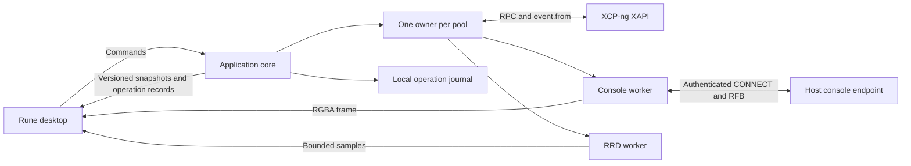

# Architecture

## Implemented alpha

The sections below define the target architecture. The initial implementation lives in
the three Cargo workspace members listed below; its current public facade is compiled
Rust in `crates/xenadmin-core/src/lib.rs` and the re-exported types.

- `Backend::connect(ConnectionOptions, Credentials)` returns a `Connection` immediately.
  `watch()` and `latest()` expose immutable snapshots, while `notify_on_change()` wakes Rune.
- A snapshot mints `ObservedVm` only for current inventory. Its private fields bind the VM
  to its pool and a process-wide unique connection generation. Both `power_action()` and
  `open_console()` require that observation and recheck freshness.
- Each connection actor owns inventory and session authority. Separate workers poll power
  tasks and decode consoles. The SQLite journal admits conflicting mutations transactionally
  and preserves task references across reconnects. There is currently one connection in the
  UI; core connections resolving to the same pool are not deduplicated yet.
- `xapi.rs` contains a bounded, handwritten decoder for the initial five event classes;
  matching-schema generated bindings and the full device graph remain planned.
- `console.rs` owns an authenticated CONNECT stream, `vnc-rs` decoding, latest RGBA frames,
  and bounded ordered input. `console_view.rs` maps Rune events and presents `Pixels`.
- The alpha has no metrics worker, bulk transfers, keyring storage, or multi-object workflows.
  Malformed event batches fail atomically and require reconnect; automatic resynchronization
  of that fault, remembered-member failover, and backoff jitter remain to be implemented.

The [alpha report](reports/2026-11-07-alpha.md) owns the verification record and remaining
gaps. Interface sketches below describe the broader design, not additional shipped APIs.

## Deployment and ownership

Ship one Linux executable. Rune owns the main thread and its windows. A background Tokio
runtime runs the application core. The core connects directly to XAPI, console endpoints,
RRD endpoints, and later bulk-transfer endpoints. No local HTTP server or resident daemon
is required. The core has no Rune dependency.



Keep these workspace boundaries small:

| Location | Owns |
| --- | --- |
| `crates/xenadmin-core` | Public application types and facade. Private modules for pool ownership, XAPI, operations, console, metrics, and local persistence |
| `crates/xenadmin-desktop` | Rune views, UI state, snapshot adaptation, frame presentation, physical input, and desktop integration |
| `tools/host-probe` | CLI consumer of the core for protocol qualification and lab acceptance |
| `crates/xenadmin-core/tests` | Local controllable HTTP, TLS, and RFB protocol fixtures |

Raw wire records and future generated bindings stay inside the core's private `xapi`
module. A view cannot bypass the application facade.
Avoid separate controller, repository, and service layers that forward the same calls.

## Caller's view

The following is interface notation for design review. It is not compiled Rust and does
not claim existing symbols. The facade hides authentication, event continuity, endpoint
selection, capability checks, task tracking, and reconnect policy.

```text
backend = Backend::start(local_services)
connection = backend.connect(saved_profile)
subscription = connection.watch()
desktop_adapter.attach(subscription, rune_waker)
```

The adapter receives immutable snapshots in background work, wakes Rune, and replaces UI
state on the main thread. It never blocks a Rune callback waiting for a host.

```text
request_id = OperationId::new()
prepared = connection.prepare(Command::StartVm(selected_vm_observation))
operation = connection.submit(request_id, prepared)
operation_panel.observe(operation.watch())
```

Preparation does not imply a confirmation dialog for every action. For force operations,
deletion, or a multi-object workflow, the UI presents the affected resources from the
prepared command before submission. Submission revalidates its preconditions.

```text
console = connection.open_console(selected_vm_observation, Interactive)
desktop_adapter.present(console.frames(), console.input())
console.release_all_input()  // on focus loss
console.close()              // on tab closure
```

## Public types and signatures

Use private constructors for validated endpoints, observed objects, and prepared commands.
Reject invalid external data when it enters the adapter. Keep ordinary domain logic pure.

```text
ConnectionId: local profile identity
PoolId: validated pool UUID
Generation: backend epoch plus monotonically increasing connection generation
ObjectId: PoolId plus object kind plus object UUID
ObservedObject: ObjectId plus Generation plus object revision
InventoryRevision: Generation plus applied event-batch sequence

ConnectionState:
    Disconnected | Connecting | Authenticating | Synchronizing |
    Ready | Reconnecting | AuthenticationRequired | TrustRequired | Failed
Freshness: Current | Stale(last_success, reason) | Synchronizing

OperationState:
    Queued | Dispatching | Tracking | Reconciling | CancellationRequested |
    Succeeded | Failed | Cancelled | PartiallyCompleted | OutcomeUnknown

Backend::start(LocalServices) -> Backend
Backend::connect(ProfileId) async -> ConnectionHandle
Backend::shutdown() async -> ShutdownReport
ConnectionHandle::watch() -> SnapshotWatch<PoolSnapshot>
ConnectionHandle::prepare(Command) async -> PreparedCommand
ConnectionHandle::submit(OperationId, PreparedCommand) async -> OperationHandle
ConnectionHandle::operations() async -> OperationRecords
ConnectionHandle::open_console(ObservedObject, ConsoleMode) async -> ConsoleHandle
OperationHandle::watch() -> OperationWatch
OperationHandle::request_cancel() async -> CancelDisposition
ConsoleHandle::frames() -> FrameWatch
ConsoleHandle::input(ConsoleInput) -> InputAdmission
ConsoleHandle::close() async
```

All fallible signatures return typed errors in implementation. Expected errors include
authentication required, certificate trust required, permission denied, unsupported
capability, stale observation, busy, disconnected, journal unavailable, and protocol error.
Preserve the upstream error code for diagnosis while presenting a useful operator message.
Unknown enum values and added fields cannot crash ordinary inventory decoding.

`ObjectId` is durable application identity. Generation-local opaque XAPI references remain
private. Task and console handles also carry their connection generation. Objects without
a stable UUID remain transient and cannot become durable operation targets. Names are labels.
Known endpoints map to one authenticated pool owner after pool identity is established.

## Pool state and synchronization

One actor owns each pool's inventory, generation, session authority, and operation state.
Workers return tagged results through bounded channels. Workers never mutate inventory.
The UI merges immutable snapshots from different pools at the read boundary.

Maintain VM-to-host, host-to-VM, VM-to-device, and SR-to-VDI indexes alongside record maps.
Update indexes in the same batch as records. Publish only a coherent applied revision.
Cheap shared immutable records avoid copying every record on each UI update. Measure before
choosing a persistent-map crate or more elaborate indexing.

For bootstrap, issue `event.from` with an empty token for the required classes, collect the
initial event-covered inventory, and fetch required non-event classes separately. Publish
Ready after the required records and relationships are available. Continue with the returned
opaque token. Apply a batch and advance its token together under the pool owner.

Qualify the exact bootstrap and non-event ordering in M0. If a batch is malformed, reject
the batch and resynchronize. Never advance past partially applied data. If continuity is
lost, keep the last snapshot visibly stale, build a replacement inventory, then swap it.
Event batches describe current inventory. They are not a durable audit log.

Use independent event, command, heartbeat, console, and transfer budgets. A long poll must
not exhaust command connections. An actor starts asynchronous work and continues receiving
messages while network requests are pending. Coordinator discovery uses remembered members,
bounded backoff with jitter, and endpoint trust checks. Authentication and permission refusal
need a distinct resolution path from transient network failure.

Increment the generation after a superseding connection, login replacement, or full resync.
Accept inventory, heartbeat, and frame results only from the active generation. Preserve late
mutation responses as operation reconciliation evidence, even when they cannot update current
inventory. Discarding a stale read and forgetting a dispatched write are different actions.

## Commands and durable outcomes

The pool owner evaluates eligibility for both UI display and submission. Check freshness,
observed object incarnation, relevant preconditions, supported API capabilities, and known
permissions. The server remains the authority for authorization and current state.
Serialize this client's conflicting mutations by affected object set. Other clients can
still change the same objects, so preflight is never a lock on the infrastructure.

Allocate an operation ID before admission. Store the normalized intention durably before
acknowledging it, then record dispatch before sending a mutation. Repeated submission with
the same ID and same intent returns the existing operation. The same ID with another intent
is an error. This provides local deduplication, not exactly-once XAPI execution.

Use SQLite for the bounded operation journal, with explicit transactions and a verified
durability setting. The journal stores stable targets, dispatch markers, known task references,
step ownership, and observed outcomes. It stores no password, cookie, or session reference.
Storage failure or exhaustion rejects new mutations before dispatch. Retention prunes terminal
history according to a documented policy. Never evict unresolved operations silently.

Prefer qualified asynchronous XAPI methods. Journal a received task reference promptly.
Use event updates where supported and bounded task polling as a fallback. Record terminal
results before any cleanup of client-owned task records. A removed task does not establish
failure or success.

After a response is lost, reconnect and reconcile task identity, target state, and
operation-specific evidence. Do not replay the mutation automatically. Matching object state
alone might not prove that this operation caused it. Preserve OutcomeUnknown and offer
inspection or explicit operator resolution when evidence cannot establish the result.

Cancellation is a request with its own outcome. Closing an observer or cancelling a local
future does not cancel a server task. Multi-step operations record each dispatch and owned
resource. They can finish PartiallyCompleted. Compensation is conditional on resource
ownership and current preconditions. There is no general atomic rollback for XAPI workflows.

## Delivery and backpressure

The initial implementation uses bounded command admission and independent concurrency limits
for each pool. Select the concrete limits during M0 and record them in one policy definition.
Do not expose arbitrary tuning knobs in the UI before measurements justify them.

Inventory batches are applied completely. A latest-value watch can coalesce published
snapshots because each snapshot has a revision and complete readable state. Operation records
remain queryable from the journal even when progress notifications coalesce. A full admission
queue returns Busy before a command is accepted.

Frames keep the latest complete framebuffer. Preserve the order of key and button changes.
If input cannot be accepted, stop the session safely and clear held input rather than lose
a key-up message. Put explicit limits on response bytes, inventory size, decoded framebuffer
dimensions, metrics samples, and transfer buffers. Report capacity refusal visibly.

## Console and metrics adapters

Resolve the VM's current advertised RFB console and resident host. Validate the destination,
open the authenticated HTTP CONNECT tunnel, then negotiate RFB on the resulting stream.
This is a host console tunnel, not the generic HTTP-proxy CONNECT destination format.
Do not assume an HTTP client exposes this upgrade correctly. Qualify the stream in M0.

The RFB component owns decoding, cursor updates, resize negotiation, pointer conversion,
and key negotiation. The desktop adapter alone converts frames into Rune `Pixels` updates.
Use a console-specific generation so replacing a console cannot display delayed old frames.
Reconnect after location/reference changes and release held input on focus loss and closure.
The initial path uses bounded RGBA uploads. Zero-copy GPU integration needs later evidence.

RRD polling has independent scheduling and bounds. Stop unnecessary high-resolution polling
for hidden views. Show unavailable samples as gaps. Management controls remain available
when metrics fail. Bulk imports and exports later use streamed HTTP bodies and operation
tracking, with separate timeout and cancellation policy.

## Local trust and lifecycle

Use normal CA and hostname validation, with explicit custom CA or endpoint-specific trust
for self-signed installations. Bind accepted certificate identity to the endpoint and detect
changes. Apply the same policy to coordinator redirects, consoles, metrics, and transfers.
Do not forward credentials to an unverified advertised destination. Support a credential
prompt when Secret Service is unavailable or locked. Session-only login keeps the client
usable without a functioning keyring. Redact secrets and sensitive URL parameters from logs.

Closing the desktop stops new admission, journals outstanding state, closes consoles, and
performs bounded local cleanup and logout where safe. Explain that server tasks may continue.
On restart, reconcile unfinished journal entries after fresh pool inventory is available.
The first release accepts that a desktop crash also stops local polling. A separate service
can be reconsidered if persistent unattended operation becomes a requirement.
